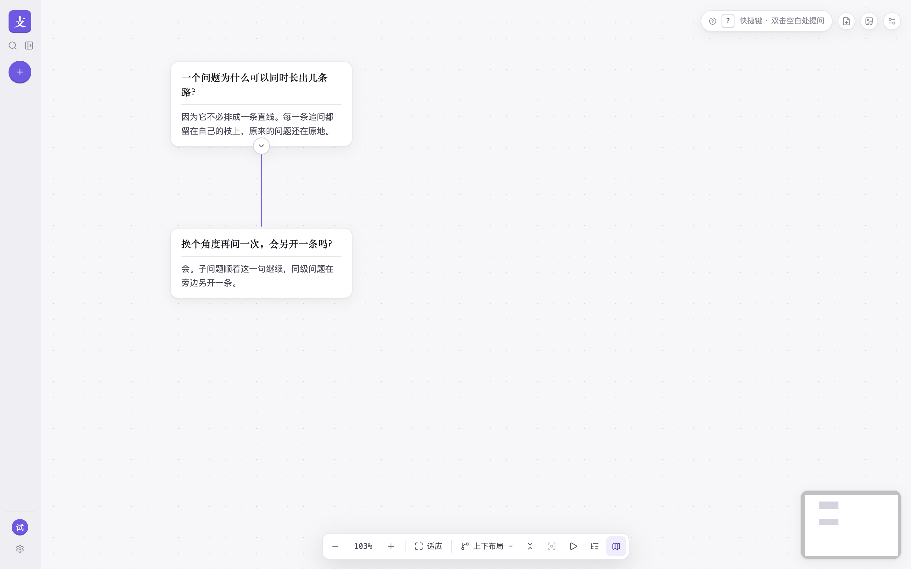

# 支流

支流是给会分叉的问题用的。一次对话不必排成一条直线。

## 为什么要一张会分叉的图

线性的聊天把每一次追问都接在同一条记录后面。一个问题常常同时长出几条路：换个角度、追一个细节、旁边再比较另一种做法。这些岔路挤在一条时间线里，回头很难看出它是从哪一句长出来的。

支流把对话画成脑图。每一条追问都留在自己的枝上，原来的问题还在它该在的地方。

## 支流是什么

支流是非线性脑图对话。

打开之后，左侧是对话列表，右侧是一张可以展开、也可以收起的脑图画板。每张卡片是一个问题，卡片之间的线表示它从哪一句继续问下去。

## 怎么用

1. 注册一个账号，或登录已有账号。
2. 新建对话，写下第一个问题。
3. 选中一张卡片，添加子问题，顺着这一句继续问。也可以添加同级问题，在旁边另开一条。
4. 不需要看整棵树的时候，把子树或回答收起；想继续看，再展开。

## 接着看

使用过程就这些。本地安装、检查和部署写在旁边：

- [本地开发](docs/开发.md)
- [检查](docs/检查.md)
- [部署](docs/部署.md)
